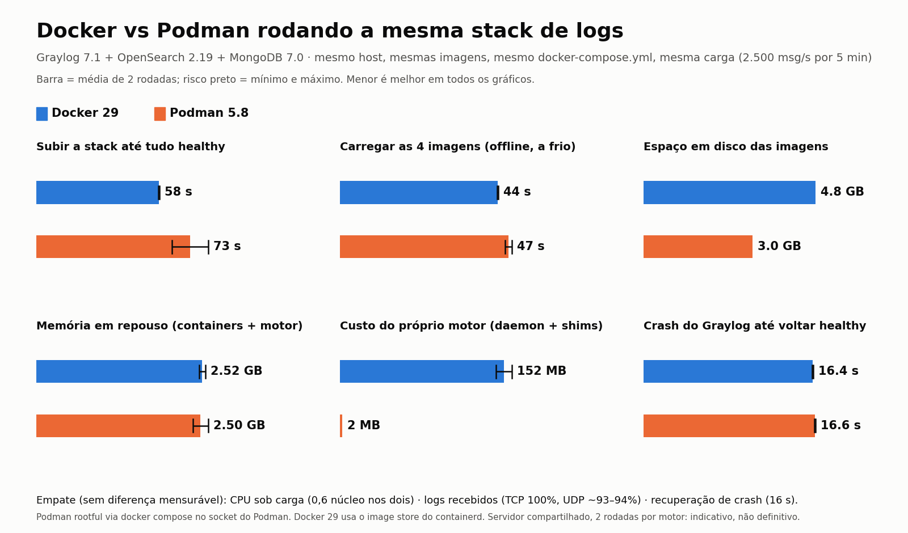

# graylog-stack

Graylog 7.1 + OpenSearch 2.19 + MongoDB 7.0 em Docker Compose, empacotável como **bundle offline**, com um **exportador por janela de tempo** que envia CSVs ao **OCI Object Storage** e deixa uma **prova de envio** auditável.

**Status: 0.9 (release candidate)** — testado em laboratório; veja [Limites conhecidos](#limites-conhecidos).

> **English summary.** A self-contained Graylog stack (Docker Compose) that installs offline with one command, provisions its own inputs, retention and pipeline through the API, and ships minute-by-minute CSV exports to an OCI Object Storage bucket. The exporter uses receive-time windows with a checkpoint, a spool folder with verified uploads, a per-file ledger, a systemd watchdog and a `proof` command. Documentation is in Portuguese; the code and comments are mostly Portuguese too.

---

## Por que existe

Quem substitui um Graylog antigo num ambiente de cliente quer **levar tudo pronto** de um laboratório e fazer o mínimo possível no local. Além disso, um export por `cron` que consulta "os últimos 60 segundos" costuma:

- **exportar ruído** (termos soltos como `error` casam com o texto de qualquer mensagem) e **perder o que importa** (a severidade real de eventos Windows está no texto, não no `level` do syslog);
- **perder minutos** (janela relativa ao relógio, sem checkpoint, `flock -n` que pula execuções);
- **perder mensagens de hosts com fuso errado** (o `timestamp` da mensagem fica horas fora da janela);
- **truncar** em um `limit` fixo.

Este projeto resolve isso com janelas absolutas por **horário de recebimento**, checkpoint, recuperação de janelas perdidas e envio verificado.

## Arquitetura

```
  ativos ── UDP 4514 ─┐                        ┌─────────────┐
  WinCollect─ TCP 3514┼─► graylog 7.1 ───────► │ opensearch  │   (rede interna, sem porta publicada)
                      │      │  ▲              └─────────────┘
                      │      ▼  │ API (token somente leitura)
                      │   mongodb 7.0       exporter (python stdlib + rclone)
                      │                        │  grava ─► spool/ ──► OCI Object Storage
                      │                        └  ledger.jsonl · status.json
                      └─ UI/API HTTP 9000
  host:  graylog-stack (CLI) · graylog-stack-watchdog (systemd timer, 1 min)
```

Quatro containers numa rede Docker interna. Só **9000/tcp**, **3514/tcp** e **4514/udp** são publicadas. O exportador também tem saída de rede (apenas para falar com o OCI), sem publicar porta alguma.

## O que vem na caixa

| Peça | O que faz |
|---|---|
| `stack/docker-compose.yml` | graylog, opensearch, mongodb e exporter; versões fixadas por **digest**; healthchecks; logs com rotação; `pull_policy: never` |
| `stack/provision/` | provisionamento **idempotente** via API: inputs syslog, retenção, regra de pipeline, conta de serviço somente leitura |
| `stack/exporter/` | exportador (Python stdlib + rclone) com janelas de 1 min, checkpoint, spool, envio verificado e ledger |
| `stack/scripts/` | `install.sh` (idempotente, `--dry-run`), `verify.sh [--oci]`, `uninstall.sh`, `graylog-stack` (CLI), `watchdog.sh`, `build-bundle.sh`, `build-rpms.sh` |
| `stack/systemd/` | unit + timer do vigia |
| `stack/tests/` | unitários (stdlib), testes de shell/compose e testes de laboratório (ponta a ponta, resiliência, carga, instalação a partir do bundle) |

## Como o exportador funciona

A cada minuto, para cada janela fechada `[T-2min, T-1min)`:

1. Consulta a API de exportação do Graylog (`/api/views/search/messages`, CSV) com `gl2_receive_timestamp:[início TO fim}` (**início inclusivo, fim exclusivo**), o filtro configurável e uma faixa de `timestamp` larga (1 ano) — a seleção real é pelo horário de **recebimento**, então relógios errados não tiram a mensagem da janela.
2. Normaliza o `timestamp` para UTC (`…000Z`) e grava o CSV no `spool/` de forma atômica; só então avança o **checkpoint**.
3. Envia **todo** o `spool/` (mais antigo primeiro) com `rclone`, **confere tamanho e MD5** no destino, registra no `ledger.jsonl` e apaga o arquivo local. Um arquivo que falha não bloqueia os demais; com o bucket fora do ar, o custo é de poucas tentativas por ciclo.

Janelas sem eventos **não geram arquivo**. Janelas perdidas (exportador parado) são recuperadas a partir do checkpoint, até um limite configurável (`MAX_CATCHUP_MIN`, padrão 12 h; uma pausa maior fica registrada e dispara alerta no vigia por 24 h). Se o journal do Graylog estiver atrasado (`JOURNAL_MAX_BACKLOG`), as janelas são **adiadas**, não fechadas com dados faltando.

**Formato do arquivo** (nome `levels_0_a_3_AAAAMMDD_HHMMSS.csv`, fuso configurável): cabeçalho `timestamp,source,level,message`; `timestamp`, `source` e `message` entre aspas duplas (com `"` duplicada), `level` numérico sem aspas; fim de linha LF — exatamente a saída de um `jq -r '[...] | @csv'`, para não quebrar quem já consome o bucket.

### Filtro padrão

```
level:[0 TO 3] OR win_level:(Critical OR Error OR Warning) OR win_event_type:16
```

- `level` é a severidade syslog (0 a 3 = emergência a erro).
- Eventos do **WinCollect** chegam sempre com `level` 5; um pipeline extrai `Level=` e `EventType=` do texto para `win_level` e `win_event_type` (inclui falhas de auditoria, `EventType=16`, por exemplo o evento 4625).
- `EXPORT_EXCLUDE_SOURCES` remove hosts específicos.

## Requisitos

- **Destino:** RHEL/AlmaLinux/Rocky 9 x86_64, 4+ vCPU, 16+ GB de RAM (os heaps padrão são 4 GB + 4 GB), 30+ GB livres. Docker é instalado a partir do bundle se faltar.
- **Máquina de build (com internet):** Docker + Compose, `rclone`, `python3`, `curl`, `jq`.
- **Cliente final:** nenhuma internet. Tudo (imagens, rclone, RPMs do Docker) vai no bundle.

## Início rápido (laboratório)

```bash
git clone https://github.com/Luiz-ZD/graylog-stack.git && cd graylog-stack/stack
tests/lab/lab.sh build        # baixa as imagens fixadas e constrói o exportador
tests/lab/lab.sh up           # sobe a stack de teste (usa /tmp/graylog-lab)
tests/lab/lab.sh wait         # aguarda todos ficarem healthy
tests/lab/lab.sh provision    # cria inputs, retenção, pipeline e a conta de serviço
tests/lab/check_provision.sh  # confere o resultado  → PROVISION_OK
```

Enviar logs sintéticos (UDP/TCP, estilo Linux ou Windows/WinCollect):

```bash
python3 tests/lab/send_logs.py --kind linux --proto udp --count 20 --level 3 --src HOST-A --tag demo
python3 tests/lab/send_logs.py --kind win   --proto tcp --count 5  --level 5 --wlevel Critical --src WIN-01 --tag demo
```

Testes:

```bash
tests/run_fast.sh             # unitários + compose + env + vigia (sem Docker em execução)
tests/lab/e2e.sh              # ponta a ponta contra um bucket S3 de teste (rclone serve s3)
tests/lab/resilience.sh       # queda de containers, bucket fora, Graylog fora, checkpoint corrompido…
```

## Instalação em produção (a partir do bundle)

Na máquina de build (com internet):

```bash
stack/scripts/build-rpms.sh      # RPMs do Docker + jq resolvidos contra userspace RHEL 9.6
stack/scripts/build-bundle.sh    # gera build/graylog-bundle-AAAAMMDD.tar.gz (~2 GB)
```

No cliente, **sem internet**:

```bash
tar xzf graylog-bundle-*.tar.gz && cd graylog-bundle-*
cp install.conf.example install.conf && $EDITOR install.conf
scripts/install.sh --dry-run     # confere o ambiente e mostra a transação de pacotes; não altera nada
scripts/install.sh               # instala (idempotente; pode rodar de novo após editar install.conf)
scripts/verify.sh --oci          # smoke test: grava, lê e apaga um objeto de teste no bucket
graylog-stack export on          # liga a exportação (começa do minuto atual, sem backfill)
graylog-stack proof 10           # confere os últimos envios no bucket
```

O `install.sh` verifica a integridade do bundle (`SHA256SUMS`), o espaço, as portas, o **fuso e o relógio** (o OCI rejeita requisições assinadas com relógio errado), aplica os `sysctl` necessários, carrega as imagens e confere os IDs, sobe a stack, provisiona e instala o vigia. A senha do `admin` é gerada e fica em `/etc/graylog-stack/admin-password` (modo 600).

### Parâmetros (`install.conf`)

| Variável | Para que serve |
|---|---|
| `HOST_IP`, `TZ`, `NTP_SERVERS` | IP anunciado, fuso (`America/Sao_Paulo` por padrão) e servidores NTP internos |
| `GL_HEAP`, `OS_HEAP` | heaps do Graylog e do OpenSearch (padrão 4g) |
| `PORT_HTTP`, `PORT_WIN`, `PORT_LIN` | portas publicadas (9000, 3514/tcp, 4514/udp) |
| `EXPORT_ENABLED` | estado inicial da exportação (`false`; depois controlado por `graylog-stack export on/off`) |
| `OCI_NAMESPACE`, `OCI_BUCKET`, `OCI_PREFIX`, `OCI_REGION`, `OCI_COMPARTMENT` | destino no OCI |
| `OCI_CONFIG_FILE`, `OCI_PROFILE`, `OCI_KEY_FILE` | `~/.oci/config` e chave de API (a chave é instalada com modo 600; **nunca** entra no bundle) |
| `EXPORT_FILTER`, `EXPORT_EXCLUDE_SOURCES` | o que exportar e quais hosts excluir |
| `WATCHDOG_THRESHOLD_MIN`, `WATCHDOG_IDLE_CHECK` | limiar do vigia e liga/desliga do alerta "sem eventos novos" |

## Operação

```bash
graylog-stack status        # containers, status do exportador e motivos do vigia
graylog-stack proof 20      # últimos 20 envios, conferidos no bucket
graylog-stack export on|off # liga/desliga a exportação
graylog-stack logs          # logs do exportador
graylog-stack version       # imagens em uso
```

- **Prova de envio:** cada envio vira uma linha em `ledger.jsonl` (janela, nome, nº de eventos, bytes, MD5 local e remoto). O `proof` confere no bucket.
- **Vigia:** uma unit systemd (`graylog-stack-watchdog`) roda a cada minuto e entra em **failed** quando algo está errado (container parado, input fora, sem eventos novos, spool envelhecido, checkpoint atrasado, lacuna de dados, erro do último envio) — qualquer ferramenta de monitoração que observe o estado de units systemd consegue alertar. Volta sozinha ao normal. Também escreve `watchdog.json` e `status.json`.
- **Retenção local:** no máximo ~10 GB (10 índices de 1 GB); o histórico vive no bucket.

## Calibrando o filtro (importante em produção)
O filtro padrão é um ponto de partida. Com tráfego real, **um ou dois tipos de mensagem costumam dominar o volume** (um agente de terceiros em falha permanente, erros internos de uma ferramenta de telemetria), enquanto problemas operacionais reais (serviço caindo em loop) são registrados pelo `systemd` como nível 4 ou 5 e ficam de fora. Para medir:

```bash
scripts/analisa-filtro.sh 60    # últimos 60 min, lê do Graylog (ou: ETC=... para outro diretório)
```
Ele mostra (A) exatamente o que o filtro envia, com os tipos mais repetidos e quantos hosts os geram, e (B) o que **não** foi exportado mas tem cara de importante: palavras de problema em Linux/rede, eventos de segurança do Windows (contas, grupos, log apagado) e o volume de `warning`. Ajuste `EXPORT_FILTER` no `install.conf` e rode o `install.sh` de novo (mantém segredos e estado); **valide o filtro no Graylog antes**, porque uma consulta inválida faz todos os envios falharem.

> Um consumidor externo pode **apagar os arquivos do bucket** minutos depois do envio. O `ledger.jsonl` guarda o tamanho e o MD5 conferidos no instante do upload; o `proof` pode marcar `FALTA` para arquivos já consumidos, e isso não é perda de envio.

## Benchmark Docker × Podman
A mesma stack, o mesmo `docker-compose.yml` e o mesmo bundle de imagens rodaram em Docker 29 e Podman 5.8, com a mesma carga (2.500 msg/s por 5 min). Resumo: **desempenho equivalente** (CPU, entrega de logs, recuperação de crash); o Podman **não tem daemon** (~110 MB parado no Docker) e ocupa **~37% menos disco** de imagens; o Docker **sobe mais rápido** (58 s contra 64–81 s). A memória dos containers é um empate. Metodologia, ressalvas e dados brutos em [`docs/bench/RESULTADOS.md`](docs/bench/RESULTADOS.md); reprodução em `stack/bench/` (`run-all.sh`, `run-cold.sh`, `compare.py`, `chart.py`).



## Segurança

- Sem segredos no repositório nem no bundle; segredos gerados na instalação em `/etc/graylog-stack` (modo 600).
- MongoDB com autenticação e sem porta publicada; OpenSearch **sem plugin de segurança**, isolado na rede interna e sem porta publicada.
- A conta de serviço do exportador é **somente leitura** (não consegue alterar inputs ou configuração).
- A UI é servida em **HTTP** na porta 9000 (sem TLS). Se precisar de HTTPS, coloque um proxy reverso na frente.
- O firewall do host **não** é gerenciado pelo bundle.

## Testes e o que eles provam

Unitários (CSV byte a byte, UTC, janelas, checkpoint, query, fluxo de upload/falha), contrato de rede do Compose, regeneração do `.env`, vigia; e de laboratório: ponta a ponta com filtro/ruído/fuso/fluxo contínuo sem perda nem duplicata nas viradas de janela, rajada de 30 mil mensagens, instalação limpa e a partir do bundle, reinício do daemon Docker (num Docker isolado), crash de cada container, bucket fora, Graylog fora, checkpoint corrompido, carga de 2.500 msg/s, retenção por tamanho, fechamento de dependências offline no userspace do RHEL 9.6 e validação das units com `systemd-analyze`.

## Limites conhecidos

- **Autenticação real no OCI** não é testada pelo laboratório: ele usa um bucket S3 de teste e um stub do endpoint. Em produção, `verify.sh --oci` confirmou gravação e leitura no bucket com uma chave de API comum. A permissão de **apagar** não é necessária (o exportador só grava arquivos novos), então a falta dela é apenas um aviso.
- **SELinux em modo enforcing:** validado numa instalação real em RHEL 9.6 (containers, instalador e vigia). Esse teste achou um defeito que o laboratório (SELinux desligado) não via: o `systemd` não executa scripts com rótulo `admin_home_t` copiados de `/root`; o instalador agora roda `restorecon` e a unit chama o script via `/bin/bash`.
- O teste de carga foi feito com heaps de 1 GB, na mesma máquina do emissor. Meça no seu tráfego.
- O OpenSearch roda sem o plugin de segurança (ver [Segurança](#segurança)).
- Hosts que enviam syslog sem fuso (RFC 3164) ficam com `timestamp` horas à frente/atrás; a **janela** usa o horário de recebimento, mas a coluna `timestamp` do CSV continua sendo a da mensagem. Corrija no `rsyslog` de origem (envie com fuso).

## Roteiro

- **1.0:** após a migração real confirmada.
- Versão **Podman** (com comparativo de consumo e tempo de subida contra o Docker).
- `proof` que distingue "removido depois do envio confirmado"; envio tolerante a arquivo consumido logo após o upload.
- Página de administração **somente leitura** (estado, últimos envios, spool, motivos do vigia).

## Licença

[MIT](LICENSE). Graylog, OpenSearch, MongoDB e rclone têm suas próprias licenças; este repositório não os redistribui — o bundle é montado por quem executa o `build-bundle.sh`.
